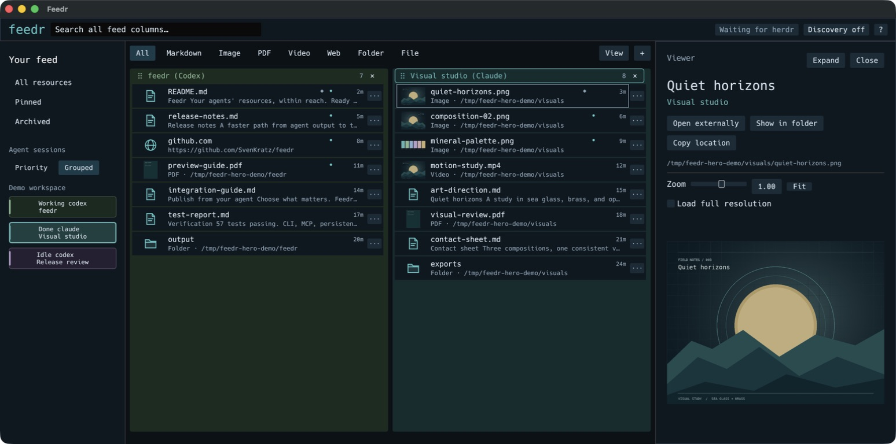

# Feedr

A dark, terminal-inspired native Rust desktop feed for agent deliverables. Feedr puts reports, media, builds and preview links in compact, session-colored columns so you can open them without copying paths from a terminal. It works directly with Claude Code and Codex; [herdr](https://herdr.dev) adds live session tracking and optional mention discovery.



*Native macOS app with demo sessions and artifacts.*

This public preview includes a persistent SQLite-backed service, live herdr sessions, MCP/CLI publishing, search and filters, pins/archive/read state, built-in image/Markdown/PDF/video previews, native open/reveal actions, and optional deterministic mention discovery. Remote artifact transfer, tray notifications and the public viewer contribution API are still planned.

Agents choose what to publish through MCP or the CLI. Optional mention discovery can also surface resources from completed output, using file-type filters and passive viewport reads that leave the agent's scroll position alone.

## Install

Download installers, release notes, source archives and checksums from [GitHub releases](https://github.com/SvenKratz/feedr/releases/latest).

| Platform | Package |
|---|---|
| macOS 14+, Apple Silicon | `feedr-vVERSION-macos-aarch64.dmg` |
| macOS 14+, Intel | `feedr-vVERSION-macos-x86_64.dmg` |
| Debian 12+ / Ubuntu 24.04+, Intel/AMD 64-bit | `feedr_VERSION_amd64.deb` |
| Debian 12+ / Ubuntu 24.04+, ARM 64-bit | `feedr_VERSION_arm64.deb` |
| Source | `feedr-vVERSION-src.tar.gz` / `.zip` |

On **macOS**, open the DMG and drag Feedr to Applications. Install PDF/video dependencies with `brew install poppler mpv ffmpeg`; images and Markdown need no additional runtimes. The first release is ad-hoc signed, **without Developer ID signing or notarization**. Gatekeeper may block the download; review the source before deciding whether to authorize it, or build from source.

To add `feedr` to your terminal PATH, choose **feedr → Install CLI…** in the app, then **Install CLI**. It creates `~/.local/bin/feedr` as a link to the installed app and adds an idempotent PATH block to your zsh/bash startup files. Open a new terminal afterward. Existing shell configuration, symlinked dotfiles and unrelated commands are preserved. The link follows app updates; if you move the app, install the CLI again. The installer refuses to link to a mounted DMG. The equivalent command is `/Applications/Feedr.app/Contents/MacOS/feedr install-cli`; `--bin-dir /absolute/path` chooses another directory and `--no-modify-path` leaves profiles unchanged. Other shells show a manual PATH step.

On **Linux**, install the downloaded package with `sudo apt install ./feedr_VERSION_amd64.deb` (substitute the actual version and `arm64` on ARM). Apt installs the media and desktop dependencies. Launch from your application menu or run `feedr gui`. The package does not install a system service: the local broker starts when needed and runs as your user. Uninstalling leaves your feed history intact.

ZIP/tar archives are also provided for portable installs and the automatic updater. Each asset has a `.sha256` sidecar, and `SHA256SUMS` covers all ten download packages. Binary packages include Rust dependency notices. Linux release validation includes package installation, installed CLI/MCP and media checks, X11 GUI startup under Xvfb, and removal preserving data; this does not cover every desktop environment or Wayland.

## Build from source

Rust 1.88 or newer is required. On macOS:

```sh
brew install poppler mpv ffmpeg
cargo run -- gui
```

Build a clickable local Mac application:

```sh
sh scripts/package-macos.sh
open dist/Feedr.app
```

The local .app is ad-hoc signed for testing, not notarized for distribution. `sh scripts/package-macos.sh release` produces an optimized build.

On Debian/Ubuntu, install native build dependencies first:

```sh
sudo apt-get install build-essential pkg-config libxkbcommon-dev libxcb-shape0-dev libxcb-xfixes0-dev libegl1-mesa-dev libwayland-dev poppler-utils libmpv2 ffmpeg
cargo run -- gui
```

Release Linux binaries are built on Debian 12 (bookworm); Debian packages declare the runtime dependencies. `packaging/feedr.desktop` supplies the desktop launcher. X11 is exercised in the release pipeline; real desktop integration and Wayland testing remain ongoing.

Create four clearly labeled demo posts and open the app:

```sh
cargo run -- demo
```

Demo posts are deduplicated and stored locally. To keep demo/testing data separate, use `cargo run -- --data-dir /tmp/feedr-demo demo`.

## Interacting with resources

The feed uses dense, neutral artifact rows. Images, PDF first pages and video posters have small thumbnails; Markdown shows a one-line document excerpt. Click the artifact to open the full preview in Feedr's shared sidebar. Its compact header puts the filename first, with a dropdown for grouped attachments. The shortened path and Open externally, Show in folder and Copy location icons share one line; hover reveals action labels and the complete path. Markdown has a **Rendered / Source** switch and a copy icon for the original Markdown, with confirmation after copying. The rendering preference also applies to feed excerpts and persists between normal launches.

Images have small **− / +** buttons, a **Fit** control, and a **Full res** checkmark beneath the image in both sidebar and expanded previews. Drag to pan; optional full-resolution loading stays within decode limits. Double-click an image or video preview, or choose the expand icon, to fill the Feedr window. **Back to feed**, Escape, or another double-click returns to the same sidebar attachment. Expanded images fit the available window and retain zoom/pan controls; video reuses the same player and playback position. Markdown uses native styled text and resolves local images relative to the document.

PDFs have page navigation, a page number control, zoom/pan, and a lazy thumbnail strip. The cache holds at most nine rendered pages; switching resources cancels PDF helpers. Video starts paused inside Feedr and provides play/pause, seeking, duration, volume, and audio. Closing the sidebar or switching resources stops that player. Source changes invalidate previews without adding duplicate cards.

Files, folders, applications and URLs appear as compact icon rows. Their primary click opens the resource in its default application; folders open in the file manager and URLs in the default browser. Use **Open externally** for media previews when you want another application, **Inspect** for other resources' sidebar details, or **Show in folder** to reveal the location. Use the **···** row menu or right-click an artifact for secondary actions. Keep, Pin and Archive apply to the whole post; its title and attachment position appear in that menu and in hover details. Each attachment has its own primary target.

Inline previews load in the background for visible resources, refresh when the file changes, and use a bounded thumbnail cache.

The desktop feed shows available resources by default. Local file, folder and application paths must exist; missing attachments are held out of the view, and a post with no available resources is hidden. Checks run before pagination and counts, and refresh in the background every two seconds so files can appear after creation and disappear after removal. The complete posts remain stored. Use **View → Show unavailable files** to inspect those entries; this preference is saved. Web links remain visible without fetching them. Remote file paths cannot be verified locally and appear only when unavailable files are included. CLI/MCP queries retain their existing complete-history default; use `feedr list --available-only` or `available_only: true` for the same availability filter.

Sessions have stable colors from a muted mineral palette, shared by their sidebar entries, feed-column backgrounds and tab headers. Artifact rows stay neutral. Selecting a row highlights its session and brings it into view without filtering the feed. Right-click a session to choose its color; choices are remembered between launches. **Use automatic color** restores its default.

The session sidebar has **Priority** and **Grouped** views, matching herdr. Priority orders live agents by blocked, done, working, idle, then unknown, with newest state changes first within each status. Grouped follows herdr's workspace and pane order under workspace headings. Saved sessions appear after live agents in either view. The selected view is remembered; switching views keeps the current feed filter and card selection.

Feeds can sit side by side in independently scrolling columns. Right-click a session and choose **Add Feed Column**, or click a session to open/focus its column. The **+** above the feeds opens session columns and restores the default **All sessions** catchall. Close any column with **×**, including the last one; this changes only the layout. Drag a tab handle to reorder columns. Session tabs show the live herdr name and agent, with the full identity on hover. Open columns and their order survive normal restarts.

Search, resource-type filters, Pinned and Archived apply across the open columns. Each column fetches and paginates its own results, so a busy catchall cannot crowd out a quieter session. Click a tab or resource row to focus that column for J/K and arrow-key navigation. Navigation visits each attachment in order and brings it into view. Filenames occupy one line, with a preview excerpt or location beneath and compact unread/pinned/discovery indicators. Post counts live in the tab header; hover for unread counts. Media opens in the shared sidebar.

## Native media dependencies

The Rust UI embeds video through libmpv's software render API; audio is handled by mpv. PDF pages render through isolated Poppler helpers (`pdfinfo`/`pdftoppm`). Video posters use FFmpeg. On macOS these are installed by `brew install poppler mpv ffmpeg`; Debian packages install `poppler-utils libmpv2 ffmpeg` as dependencies. Homebrew locations are searched explicitly so launching from Finder works without a shell PATH. Media runtimes are separate system dependencies, with their own upstream licenses.

| Media | macOS native backend checks | Linux |
|---|---|---|
| PDF, including multi-page navigation | Poppler rendered first/last pages; corrupt files report an error | Same backend checks required for both release architectures |
| MP4 / MOV: H.264 + AAC | Frames, selected audio track, seek and pause passed | Same checks through the installed Debian package |
| WebM: VP9 + Opus | Frames, selected audio track, seek and pause passed | Same checks through the installed Debian package |
| MKV: H.264 + Opus | Frames, selected audio track, seek and pause passed | Same checks through the installed Debian package |

PDFs over 512 MiB and more than 100,000 pages are rejected for preview. Encrypted PDFs requiring a password report the Poppler error and retain Open externally. Each helper has a 25-second time limit and bounded output. Image decoding is limited to 128 MiB and 16,000 pixels per dimension. Other codecs depend on the installed mpv/FFmpeg build and report failures in the sidebar.

Backend references: [libmpv software rendering](https://github.com/mpv-player/mpv/blob/v0.40.0/include/mpv/render.h), [official software rendering example](https://github.com/mpv-player/mpv-examples/blob/master/libmpv/sdl/main_sw.c).

## Mention discovery

Discovery is **off by default**. Open **Discovery off** in the app for one all-session switch and independent file-type controls: Text, Code, Markdown, Image, Video, Audio, PDF, Web links, Folders, Apps and Other files. For example, leave Markdown on and Code off to surface documents without source/configuration files. All/None shortcuts are available. Choices are saved; existing unkept mentions of disabled types are hidden until re-enabled, while kept/pinned items, explicit posts and archived history remain accessible. Type selection controls new discoveries as well as feed visibility. Existing preferences initially allow every type.

The scanner takes a passive snapshot of the currently visible screen for each enabled live agent after it stops working, bounded to 64 KiB. It uses herdr's `visible` read source and never requests recent-history collection, which can scroll an agent's interface to retrieve older output. There is no fallback to an interactive history read. It strips terminal controls, extracts Markdown links, HTTP(S) URLs, file URIs and paths with fixed rules, and suppresses fenced code/build noise and configured dependency paths. No LLM or automatic launch is involved. Unresolved locations remain labeled and cannot open a guessed local file. Missing or changing files remain creating until stable across observations. Temporary socket reads retry quietly; repeated delays show a retry notice instead of an OS error code.

Discovered cards show their source on hover and offer **Keep** or **Dismiss**. Repeated mentions reuse stable session/host/location keys, including after restart or dismissal. Mentions matching an explicit post reuse it; a later explicit publication of the same resource promotes the discovered card while preserving retry identity. Plain paths containing spaces should be quoted or use Markdown links.

```sh
feedr sessions
feedr discovery enable --session SESSION_ID
printf 'Report: [open](</absolute/path/report.pdf>)\n' | feedr discovery ingest --session SESSION_ID
feedr discovery watch-log --session SESSION_ID --format codex /absolute/path/session.jsonl
feedr discovery watch-log --session SESSION_ID --format claude /absolute/path/session.jsonl
feedr discovery status
feedr discovery disable
```

New log watches start at the current end; `--from-start` explicitly opts into reading existing records. Supported formats: plain complete lines, Codex assistant `response_item`/`event_msg` records, and Claude assistant text records; `jsonl` recognizes both harness envelopes. User/tool records and incomplete final lines are ignored until complete. Cursor offsets persist; truncation/rotation is handled, and scans read at most 256 KiB per log per pass. Up to 32 logs and 256 pending file observations are bounded. Pane discovery sees only the current viewport: off-screen messages and paths broken across wrapped screen rows can be missed. Use completed-message hooks or session-bound logs to discover those resources without moving the agent's viewport. Paths in logs resolve against the explicitly bound session's recorded working directory and host.

For a completed-message hook, pipe assistant text to `feedr discovery ingest --session SESSION_ID --source hook`. Existing harness configuration is never changed automatically. To customize exclusions/settling/source bindings, save `feedr discovery status`, edit its JSON, then run `feedr discovery configure --input config.json`; `sessions: null` means all sessions subject to exclusions, while `sessions: []` selects none.

## Publish from an agent

```sh
cargo install --path . --locked
feedr post --title 'Report is ready' --body 'Findings and next steps.' ./report.md
feedr post --title 'Try the app' http://localhost:3000
feedr post --title 'Generated resources' ./output ./output/diagram.png
feedr sessions
feedr list --search report
feedr doctor
```

Paths resolve relative to the producer's working directory. The process inherits herdr pane/workspace/socket context when run from a herdr pane. Outside herdr, an agent can supply its own client, project and native session context; otherwise the post stays unassigned. `--session ID` binds to a known ID from `feedr sessions`. Never guess a focused pane. Mention discovery stays off until you enable it.

`feedr post --input payload.json` accepts a `PostInput` object; `--input -` reads stdin. `feedr update --input update.json` accepts an update with `id` and `expected_revision`. Omitted update fields are unchanged. Both commands return JSON and fail with a nonzero exit status on errors.

```json
{"title":"Report is ready","body":"Review the findings.","resources":[{"uri":"/absolute/path/report.md"}],"idempotency_key":"report-v1"}
```

## Agent setup and MCP

On first launch, select **Claude Code**, **Codex**, or both, then choose **Enable publishing**. Reopen this panel with **?** or **feedr → Agent setup…**. It connects the installed app through MCP and adds a short publishing rule to the client's global instructions, so agents are told to share finished documents, media, builds, output folders and preview links before saying they are ready. Routine code edits and logs stay out. Herdr, terminal PATH setup and mention discovery are optional.

**Restart the selected clients after setup.** With completion reminders enabled, Codex also requires reviewing and trusting Feedr's hooks in `/hooks`. Feedr does not bypass client trust or permissions. **Send test share** checks local delivery with a welcome document; it does not claim to test a model's willingness to publish.

The optional completion check inspects only the final assistant message supplied by the client. It verifies mentioned files exist and checks explicit publication receipts for the producing session and file revision. A likely missed deliverable prompts one bounded reminder; offline Feedr never holds up completion. No terminal scrolling, transcript scanning, auto-posting or discovery activation is involved. Importance is guided by instructions and deterministic heuristics, so model adherence and unusual output formats can still vary.

Setup shows the files it will change. It merges the Feedr entry and hooks, preserves other settings/instructions, and saves private backups under `agent-setup/backups/` in Feedr's data directory. Claude Code uses `~/.claude.json`, `~/.claude/CLAUDE.md` and `~/.claude/settings.json`; Codex uses `~/.codex/config.toml`, the active global `AGENTS.override.md` or `AGENTS.md`, and `~/.codex/hooks.json`. Existing `CLAUDE_CONFIG_DIR` and `CODEX_HOME` locations are respected. **Disconnect** removes Feedr's managed integration. Install the app in a stable, writable location before connecting; setup refuses mounted disk images.

**Manual MCP configuration** contains copyable JSON and complete registration commands using the running app's full executable path. Manual registration alone exposes tools; it does not install the publishing policy or completion reminders. Client references: [Codex global instructions](https://learn.chatgpt.com/docs/agent-configuration/agents-md), [Codex hooks](https://learn.chatgpt.com/docs/hooks), [Claude Code memory](https://code.claude.com/docs/en/memory), [Claude Code hooks](https://code.claude.com/docs/en/hooks).

Print the exact launch configuration for the installed binary:

```sh
feedr mcp-config
feedr mcp-config --session SESSION_ID
```

Add the printed `mcpServers.feedr` entry to your MCP client's configuration. It launches `feedr mcp` over stdio. Tool names: `feedr_post`, `feedr_update`, `feedr_list`, `feedr_get`, `feedr_sessions`. The MCP process writes protocol messages to stdout; service diagnostics go to its local log. A session lookup is not required to publish. Supply known `context.cwd`, `context.agent` and `context.native_session_id` for standalone session attribution, or an explicit known `session_id`; an arbitrary focused pane is never used.

Agent guidance: [integrations/agents/INSTRUCTIONS.md](integrations/agents/INSTRUCTIONS.md). An optional herdr plugin action is in `integrations/herdr/`; it requires `feedr` on PATH. Agent configuration changes only when you choose **Enable publishing** or **Disconnect**. The CLI equivalent is `feedr agent-setup enable --client codex` (or `claude`), with `--no-reminders` to install only MCP and the policy; `status` and `remove` inspect or disconnect. `--config-dir /absolute/path` targets a custom profile.

## How it works

Agent → MCP/CLI → versioned Unix socket → local Rust service → SQLite → native egui desktop UI.

The service subscribes to herdr lifecycle events and reads authoritative snapshots. It discovers `HERDR_SOCKET_PATH`, `~/.config/herdr/herdr.sock`, and named sockets under `~/.config/herdr/sessions/`. Add a nonstandard local socket with `feedr connect /absolute/path/herdr.sock`. A disconnected or older unsupported server is reported in the connection panel and `feedr doctor`.

The broker starts automatically on the first CLI/MCP/GUI use and continues when windows close. It acknowledges posts after a SQLite transaction commits. Session-scoped idempotency keys make publication retries safe; expected revisions prevent conflicting updates. Files are live references, not archived copies. Missing or unmounted files stay in history and are hidden from the desktop feed by default; **View → Show unavailable files** includes them. Remote contexts cannot open a same-named local file. Herdr sessions without native IDs use terminal identity; a same-agent replacement inside the same terminal cannot always be distinguished until the harness reports a native session ID.

## Automatic updates

Feedr checks [GitHub releases](https://github.com/SvenKratz/feedr/releases) at startup when due and every six hours while running. New stable releases download and install automatically, as requested; a five-second restart countdown offers **Later**. The **?** panel shows the installed version and live update status; click that status for release notes and update controls. When automatic updates are enabled, opening **?** checks for releases if this run has not checked yet. With automatic updates disabled, the panel offers a manual check. The version beside **feedr** also opens release notes, download progress, **Check now**, and the automatic-update switch. Turning automatic updates off leaves manual checking and installation available.

Only a newer semantic version with an exact macOS/Linux and Apple Silicon/Intel/ARM package match is eligible. Feedr verifies GitHub's SHA-256 asset digest before extraction, rejects unsafe archive entries, and validates the staged executable's version (and the macOS bundle signature). The app closes before replacement, drains the local service's current requests, then restarts with the same data directory. The previous application is kept in its staging folder and restored if the new app fails its startup check. Development executables in Cargo build directories are not replaced automatically; macOS requires a Feedr.app bundle and the installation folder must be writable. **Debian installations** in `/usr/bin` check GitHub for updates and release notes, but installation stays with apt: download the new `.deb` and run `sudo apt install ./feedr_VERSION_ARCH.deb`. The portable updater never overwrites package-manager-owned files.

Public releases need no sign-in. For private repositories, Feedr uses the existing `gh auth login` credential through GitHub CLI; it never stores a GitHub token in app preferences. No releases yet, missing platform packages, unavailable authentication, and interrupted downloads have distinct status messages. Network or checksum failures leave the installed application in place.

```sh
feedr update-check     # Latest release metadata and notes as JSON, or null if none exist
feedr stop             # Gracefully stop the local feed service
```

To publish a release, update Cargo's version and `packaging/release-notes.md`, then push the matching `vVERSION` tag. The workflow builds macOS and Linux for aarch64 and x86_64, validates installers and media, and creates source archives from the tagged tree. It uploads a draft, verifies all ten packages and their GitHub SHA-256 digests, then publishes the complete release. Published releases are never overwritten. See [release build instructions](packaging/RELEASING.md) for local packaging and optional Developer ID signing/notarization.

## Data and diagnostics

Default macOS location: `~/Library/Application Support/feedr/`. Linux: `$XDG_DATA_HOME/feedr/`, normally `~/.local/share/feedr/`. The directory contains `feedr.sqlite3`, `feedr.sock`, `broker.lock`, `broker.log`, `update.lock`, update status/installer logs under `updates/`, and optional demo files/socket configuration. The directory is user-only and the socket is mode 0600. `--data-dir DIR` or `FEEDR_DATA_DIR` selects an isolated store; use a short path because Unix sockets have path-length limits.

The local service is not exposed on TCP and requires no cloud account. Any process running as your user may access the local service. Remove demo cards with Archive. To stop a testing service, stop its `feedr … serve` process; the next client starts it again. During development, restart an existing broker after rebuilding so the service and GUI use the same version.

Keyboard: Ctrl+Alt+F summons the running app on macOS/X11 when registration is available. On Wayland use the desktop launcher. Cmd/Ctrl K searches; J/K or arrow keys select artifact rows; P pins; Esc closes the preview. New cards are held behind a “new resources” button while a selected card is being read.

## Verification

```sh
cargo fmt --check
cargo clippy --all-targets -- -D warnings
cargo test --all-targets
cargo build
python3 scripts/smoke.py target/debug/feedr
python3 scripts/media-smoke.py target/debug/feedr
```

The smoke test uses isolated directories and checks broker restart recovery, concurrent publishers, CLI deduplication, MCP initialization/tool calls, post updates and stale revision rejection. It also installs integrations into synthetic client profiles and exercises standalone publication, native session attribution, bounded completion reminders, revision checks and offline behavior with discovery off. It cleans up its own child processes.

It also checks opt-in mention ingestion, durable dismissal, explicit synthetic-session binding, and partial JSONL tailing without scanning real user panes. Media smoke checks generate temporary PDF/video fixtures and exercise the real Poppler/libmpv backends; supply an output directory as a second argument to retain fixtures for manual UI testing. CI sets `FEEDR_TEST_NULL_AUDIO=1` for an audio sink without hardware; normal playback uses the system audio output. CI configuration is not evidence of a completed Linux runtime check.

## License

Feedr is licensed under [Apache 2.0](LICENSE). Native media runtimes are separate dependencies with their own licenses.
